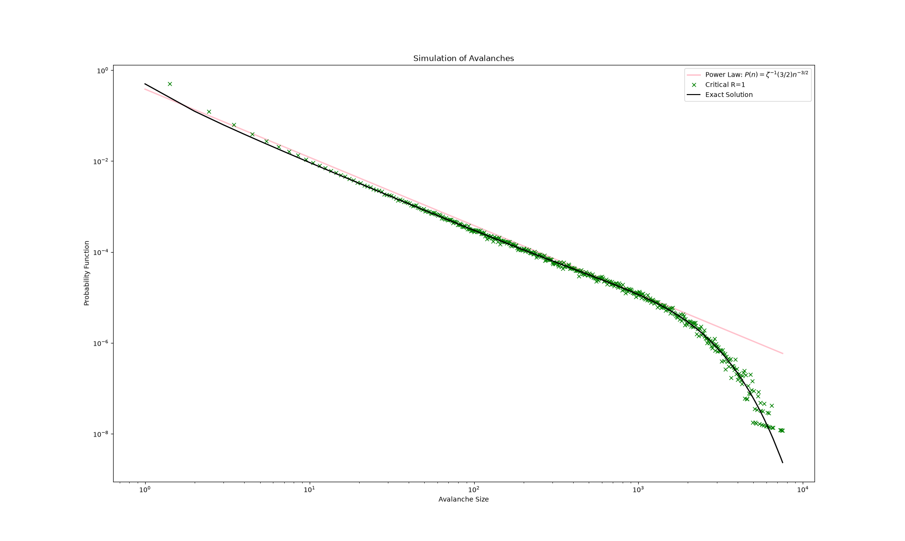
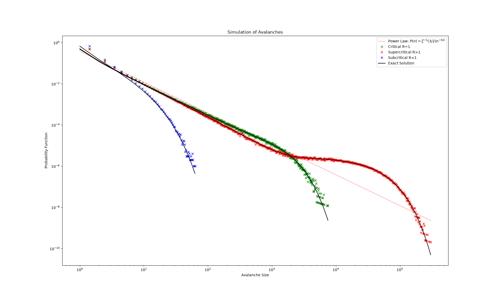
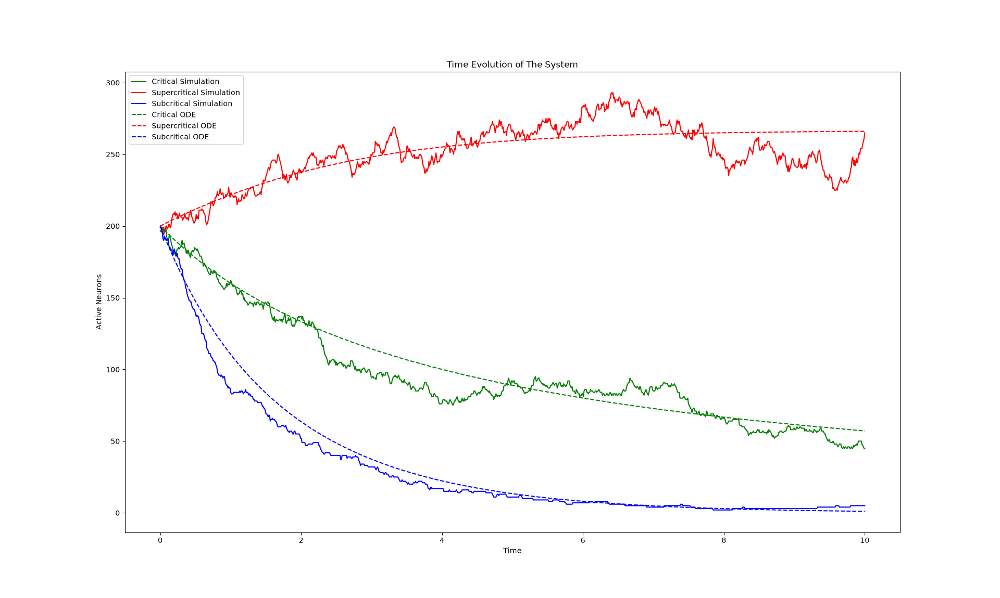

#+TITLE:Avalanche's Progress Report

#+OPTIONS: tex:t toc:nil
#+latex_class: article
#+latex_class_options:
#+latex_header: \newcommand{\avg}[1]{\langle #1 \rangle}
#+latex_header: \usepackage{amsmath}
#+latex_header: \usepackage{amssymb}
# #+latex_header: \usepackage[thinc]{esdiff}
#+latex_header: \usepackage[thinc]{physics}
#+latex_header: \usepackage{geometry}
#+latex_header: \geometry{left=2.5cm,right=2.5cm,top=2.5cm,bottom=2.5cm}
#+latex_header_extra:
#+description:
#+keywords:
#+subtitle:
#+author: Soroush Seirani G.
#+latex_footnote_command: \footnote{%s%s}
#+latex_engraved_theme:
#+latex_compiler: xelatex
#+date: \today

* Objectives
- Fixing previous mistakes
- Replicate two graphs from the paper

* Fixing Previous mistakes
In the previous report, I had included a faulty graph of the
simulation results. There were two problems with it:
1. The bins used to draw the histogram were of equal size while they
   should've scaled logarithmically
2. The fitted power law didn't look like a straight line in the
   log-log graph. That's because instead of fitting $A x^{3/2}$ I had
   absent mindedly fitted $A x^{3/2} + B$. That's fixed now as well.

I noticed there's no need to fit the power law because $A$ can be
uniquely determined from the normalization condition:

#+begin_export latex
\begin{align*}
  \sum_{n=1}^{\infty}P(n) &= 1\\
                  &= \sum_{n=1}^{\infty} A n^{-3/2}\\
                  &= A \sum_{n=1}^{\infty} n^{-3/2}\\
                  &= A \zeta(3/2) = 1\\
  \rightarrow A &= \frac{1}{\zeta(3/2)}
\end{align*}
#+end_export

Where $\zeta$ is Reimann's zeta function.

You can see the result of $1,000,000$ simulations below:
#+begin_center

#+end_center

* Replicating The First Two Graphs
#+begin_center

#+end_center

#+begin_center

#+end_center
