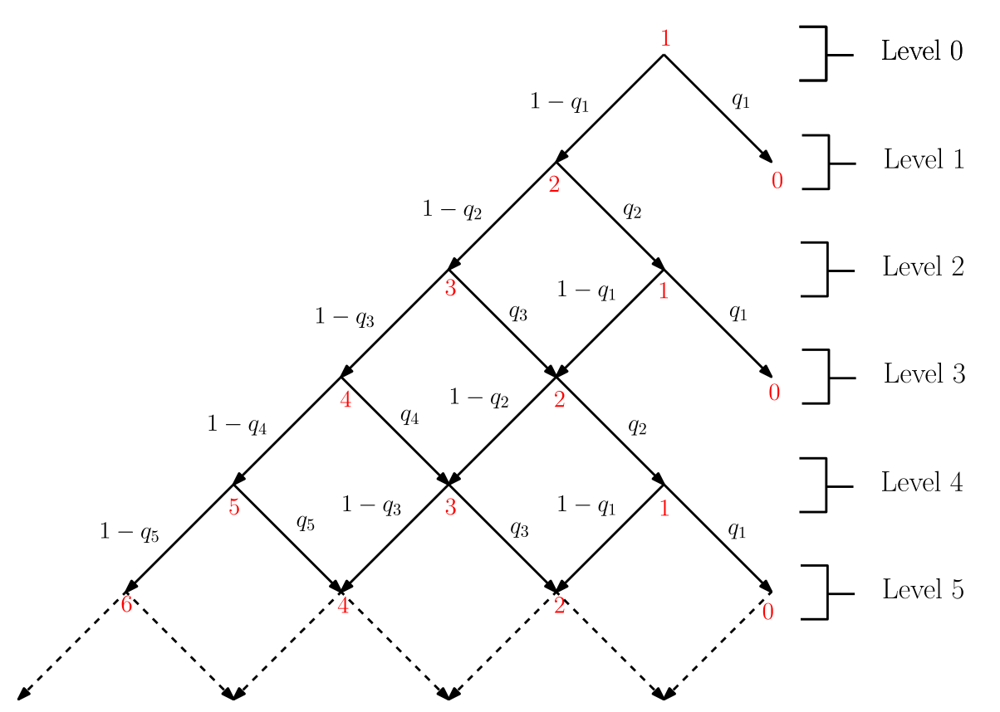

#+TITLE:Avalanche's Progress Report 3

#+OPTIONS: tex:t toc:nil
#+latex_class: article
#+latex_class_options:
#+latex_header: \newcommand{\avg}[1]{\langle #1 \rangle}
#+latex_header: \usepackage{amsmath}
#+latex_header: \usepackage{amssymb}
# #+latex_header: \usepackage[thinc]{esdiff}
#+latex_header: \usepackage[thinc]{physics}
#+latex_header: \usepackage{geometry}
#+latex_header: \geometry{left=2.5cm,right=2.5cm,top=2.5cm,bottom=2.5cm}
#+latex_header: \usepackage{xcolor}
#+latex_header: \usepackage[unicode]{hyperref}
#+latex_header: \hypersetup{
#+latex_header:   colorlinks=true,
#+latex_header:   linkcolor=blue,
#+latex_header:   citecolor=blue,
#+latex_header:   urlcolor=blue
#+latex_header: }
#+latex_header: \urlstyle{same} % keep URL font same as main text
#+latex_header_extra:
#+description:
#+keywords:
#+subtitle:
#+author: Soroush Seirani G.
#+latex_footnote_command: \footnote{%s%s}
#+latex_engraved_theme:
#+latex_compiler: xelatex
#+date: \today

* Objectives
- What is the problem?
- What is our goal?
- Description of Algorithms:
  - Simple Time Evolution
  - Atemporal Gillespie (aka SIS)

* Introduction

The aim of this study is to find the defining characteristics of
critical networks. By sampling and calculating the exact distribution
of avalanche sizes we look for the power law often associated with
such distributions. As we have seen the power law doesn't necessarily
apply in a finite-size system.

* The Stochastic Model

Our stochastic model of the network is as follows where $Q$ denotes
quiescent (off) and $A$ active (on):

#+begin_export latex
\begin{align}
  P(Q\rightarrow A) dt &= f(s_i(t))\dd t,\\
  P(A\rightarrow Q) dt &= \alpha \dd t.
\end{align}

where:
\begin{align}
  s_i(t)&=\sum_{j\ne i} wa_j(t)/N+h_i,\\
  f(x)&=x.
\end{align}
#+end_export

Note how the system size $N$ can affect the dynamics of the
network. As I've demonstrated in previous reports, the ratio
$R=\frac{w}{\alpha}$ tells us what the phase of the network is:

#+begin_export latex
\begin{gather}
  \begin{cases}
    R < 1 & \text{Subcritical}\\
    R = 1 & \text{Critical}\\
    R > 1 & \text{Supercritical}
  \end{cases}
\end{gather}
#+end_export

** Definition of Avalanche Size

It's important to determine what we exactly mean by the avalanche
size:

#+begin_export latex
\begin{center}
  \fbox{Size of an Avalanche: The number of times nodes go from state Q to A}
\end{center}
#+end_export

By this definition it should be obvious that it doesn't matter whether
one single node keeps turning off and on for a 100 times or 100 nodes
turn on together.

** Evaluation of the Distribution

In the rest of the report I'll briefly explain the three methods I
used to obtain the distribution, two of which were numerical and one
was analytical and exact.

* Numerical Sampling

** Time Evolution

This is the most simple and naive direct sampling method. We allocate
an array of size $N$ and turn on one node. Next we calculate the
probability of each node to flip in the next $dt$. Then we pull a
random number for each node and flip the nodes passing their
probability of flip. By keeping count of the number of turn-ons we
obtain the avalanche size.

This method, despite being very simple, is computationally expensive
because in many timesteps nothing actually happens. The next method is
vastly more efficient by being entirely atemporal.

** The Gillespie Algorithm

In our stochastic model, the weights are all equal $w_{ij}=w$ so the
probability of a node to flip only depends on its current state. We
take advantage of this and instead of tossing a coin for every node,
we toss to see wether the next event is a turn-on or a turn-off.

Assuming there are currently $A$ active nodes, $q_i$ denotes the
probability of the next event being a turn-off:
#+begin_export latex
\begin{align}
  q_i &= \frac{\alpha N}{w(N-i)+\alpha N}= \frac{N}{R_0(N-i)+N}\\
  1-q_i &= \frac{w(N-i)}{w(N-i)+\alpha N} = \frac{R_0(N-i)}{R_0(N-i)+N}
\end{align}
#+end_export

By rolling a dice for each subsequent event and counting the turn-ons
until there are zero active nodes, we can obtain the avalanche
size. I've included a figure from the original paper for clarity. The
red numbers denotes the number of active nodes:

* Exact Solution

By building on the probability tree we can exactly calculate the
probability of an avalanche of a specific size. Assume we have a
vector $\mathbf{p}$ of length $N+1$ where the $i$th element denotes
the probability of our system having $i-1$ active nodes. We initially
set the second element to one and the rest to zero. By building a
tridiagonal matrix we can see how the probability distribution evolves
after every event (in every layer):

#+begin_export latex
\begin{gather}
  \mathbf{A} = 
  \begin{pmatrix}
    1      & c_1    &        &        &        &        &        \\
    b_1 & 0 & \ddots &        &        &        &        \\
           & \ddots & \ddots & \ddots &        &        &        \\
           &        & b_i    & 0      & c_i    &        &        \\
           &        &        & \ddots & \ddots & \ddots &        \\
           &        &        &        & \ddots & \ddots & c_N \\
           &        &        &        &        & b_N    & 0
  \end{pmatrix}
\end{gather}
#+end_export

where $b_i=(1-q_{i-1})$ and $c_i=q_{i}$ except for $i=0$ where $b_0=0$. Note that I've used a slightly different formulation from
the paper where $\mathbf{A}$ is a square matrix of size $N$ instead of
$N+1$.

Since the first column of our matrix is zero, an avalanche that has
died out won't come back to life. Let $\mathbf{e_i}$ be a vector of
size $N+1$ filled with zeros except at $i$ then the probability of the
avalanche to have died at step $l$ becomes:

#+begin_export latex
\begin{gather}
  P_\text{death}(l)=\mathbf{e_1^\top} \mathbf{A}^l e_2
\end{gather}
#+end_export

But this isn't what we're looking for, we want the probability of an
avalanche of size $k$ to have happened. We can get that by:

#+begin_export latex
\begin{gather}
  P(k) = q_1 \mathbf{e_2^\top} \mathbf{A}^{2(k-1)} \mathbf{e_2}
\end{gather}
#+end_export

Note that $\mathbf{A}$ is raised to the power of $2(k-1)$ and not $2k$
because we count the first turn-on (in $\mathbf{e_2}$) as part of the
avalanche size as well.

In the end of this section, I have to mention I think the
representation of the matrix $\mathbf{A}$ in the original paper where
the matrix is represented as:

#+begin_center
\mathbf{A} = 
\begin{pmatrix}
0      & c_1    &        &        &        &        &        \\
\ddots & \ddots & \ddots &        &        &        &        \\
       & \ddots & \ddots & \ddots &        &        &        \\
       &        & b_i    & 0      & c_i    &        &        \\
       &        &        & \ddots & \ddots & \ddots &        \\
       &        &        &        & \ddots & \ddots & \ddots \\
       &        &        &        &        & b_N    & 0
\end{pmatrix}
#+end_center

is improper because it doesn't explicitly state what index $c_i$ ends
at or what index $b_i$ starts from. Also by not dedicating an extra
column to the matrix to represent the dead state, the sum of
probabilities doesn't equal $1$. These are the reasons I find this
notation ambiguous and confusing.

* Programming Aspects

** Migration to Julia
I moved the codebase from Python to Julia for performance which is
available in [[https://git.swodig.ir/swodig/avalanche][this repository]][fn:1] along with the source of all of the reports.

** Parallelism
I made use of parallelism to speed up direct sampling. Since my CPU
has 20 logical cores I managed to speed up the simulation by 20 times.

* Footnotes

[fn:1]: https://git.swodig.ir/swodig/avalanche
