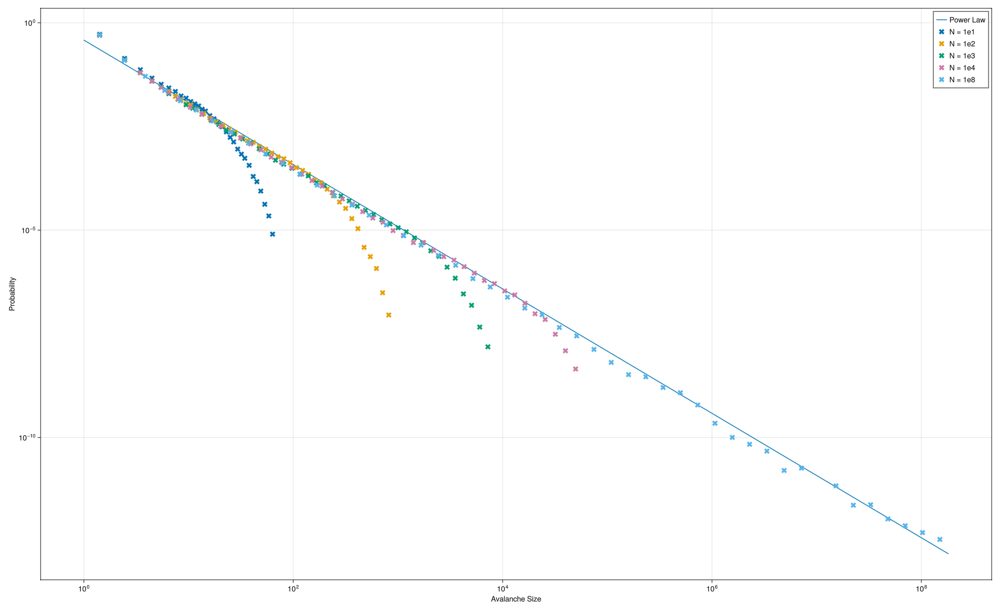
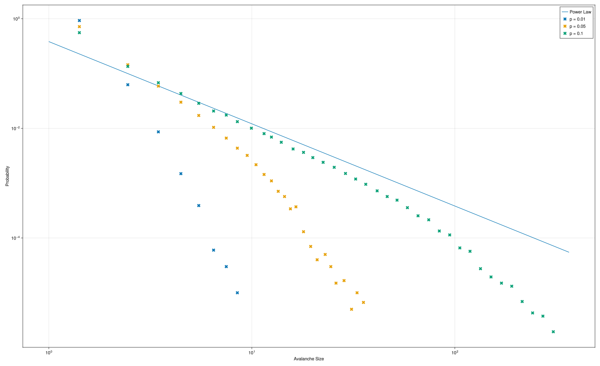
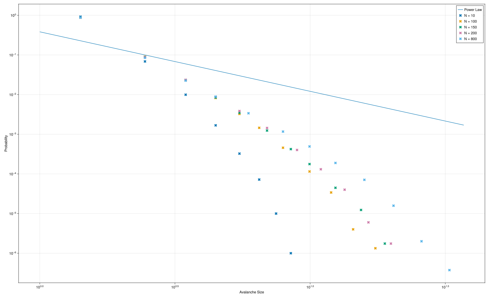

#+TITLE:Avalanche's Progress Report 4

#+OPTIONS: tex:t toc:nil ':t
#+latex_class: article
#+latex_class_options:
#+latex_header: \newcommand{\avg}[1]{\langle #1 \rangle}
#+latex_header: \usepackage{amsmath}
#+latex_header: \usepackage{amssymb}
# #+latex_header: \usepackage[thinc]{esdiff}
#+latex_header: \usepackage[thinc]{physics}
#+latex_header: \usepackage{geometry}
#+latex_header: \geometry{left=2.5cm,right=2.5cm,top=2.5cm,bottom=2.5cm}
#+latex_header: \usepackage{xcolor}
#+latex_header: \usepackage[unicode]{hyperref}
#+latex_header: \hypersetup{
#+latex_header:   colorlinks=true,
#+latex_header:   linkcolor=blue,
#+latex_header:   citecolor=blue,
#+latex_header:   urlcolor=blue
#+latex_header: }
#+latex_header: \urlstyle{same} % keep URL font same as main text
#+latex_header_extra:
#+description:
#+keywords:
#+subtitle:
#+author: Soroush Seirani G.
#+latex_footnote_command: \footnote{%s%s}
#+latex_engraved_theme:
#+latex_compiler: xelatex
#+date: \today

* Types of Networks
** Erdos-Reyni Networks
There are two variants of this network but I only use one of
them. This network is defined by the possiblity of each edge to
exist. We assume a constant probability $p$ for each edge to exist and
roll our dice to construct the network.

Since the probability of each edge's existance is constant, the
expected degree is:

#+begin_export latex
\begin{gather}
  \avg{k} = p(N-1) \approx pN \quad \text{for large $N$}
\end{gather}
#+end_export

And the probability distribution of degrees follows a binomial
distribution:

#+begin_export latex
\begin{gather}
  P(k) = \begin{pmatrix}
    N-1\\
    k
  \end{pmatrix} p^k (1-p)^{N-1-k}
\end{gather}
#+end_export

Which due to its dependence on the system's size $N$ isn't scale-free.

** Barbasi-Albert Networks
This network is defined using the algorithm used to generate it:

1. The network is initialized with $m \ge 2$ nodes which is usually
   fully connected
2. One node is added and each edge which could be
   connected to it exists with prbability:
   #+begin_export latex
   \begin{gather}
     p_i = \frac{k_i}{\sum_j k_j}
   \end{gather}
   #+end_export
3. If the size of the system isn't yet equal to $N$ go back to step 2.

This gives us a scale-free network but not the most generic one. It
assumes certain properties about the network. I plan to use another
algorithm in the future to get more general results.

* Determining Distributions From Samples
Currently I've implemented functions for directly picking a sample
avalanche size. By picking a big number of samples and drawing the
histogram I can observe what the probability distribution looks like
but how could I rigorously determine the probability distribution?

To address this problem I did some research and came across the
"likelihood function". Here I'll explain what methods I used to
find the analytical expression for the measured samples.

Assume a series of experiments (direct samples) denoted by $X_i$. The
likelihood function is defined:
#+begin_export latex
\begin{gather}
  L(\boldsymbol{X}) = \prod_{i}P(X_i)
\end{gather}
#+end_export

Which is maximized if the function $P$ is the right probability
distribution for our samples. So we can have a generic distribution
which depends on multiple variables $\boldsymbol{\theta}$:
#+begin_export latex
\begin{gather}
  L(\boldsymbol{X},\boldsymbol{\theta}) =  \prod_{i}P(X_i,\boldsymbol{\theta})
\end{gather}
#+end_export

And I can using optimization techniques to find the right
$\boldsymbol{\theta}$ which uniquely determines the correct
distribution. Note that despite being able to compare multiple
probability distributions, we still have to provide
$P(x,\boldsymbol{\theta})$ but that won't be a problem for us because
we can make good guesses :P

Note that if we work with $L$ directly we'll have numerical problems
because the product of probabilities will be much smaller than the
available precision so we'll work with its logarithm:
#+begin_export latex
\begin{align}
  L(\boldsymbol{X},\boldsymbol{\theta}) &=  \prod_{i}P(X_i,\boldsymbol{\theta}),\\
  \ln L(\boldsymbol{X},\boldsymbol{\theta}) &= \ln  \prod_{i}P(X_i,\boldsymbol{\theta})\\
    &= \sum_i \ln P(X_i,\boldsymbol{\theta})
\end{align}
#+end_export

* Results and Future Work
So far I've run three simulations. The resulting graphs and their descriptions are below:
#+begin_center

Fully Connected Network with Variable System Size

Erdos-Reyni Network with Variable $p$

Barabasi-Albert Network with Variable Size and $m0=8$
#+end_center

I'm still working on developing the software to quantitavely assess which probability distribution is appropriate. Once that's done I'll include those results as well.
